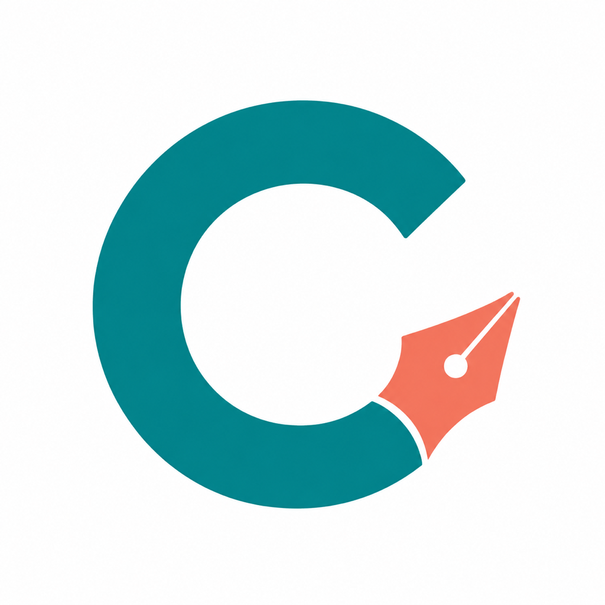
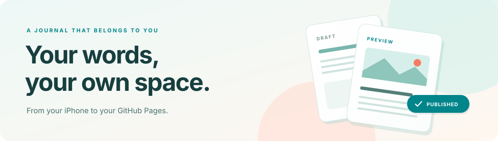
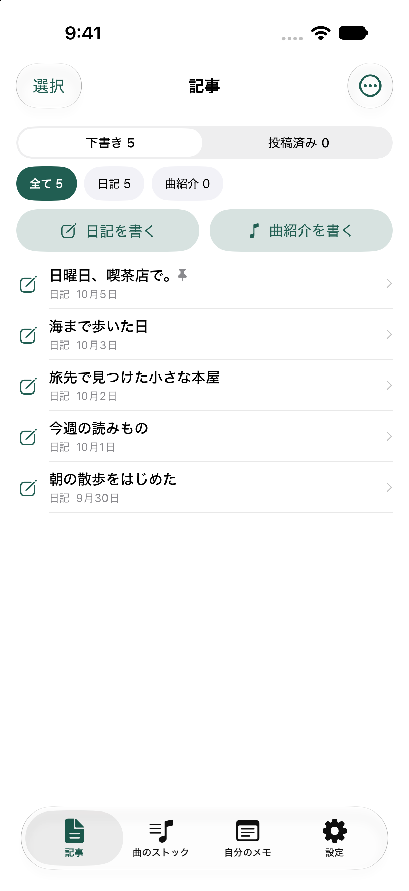
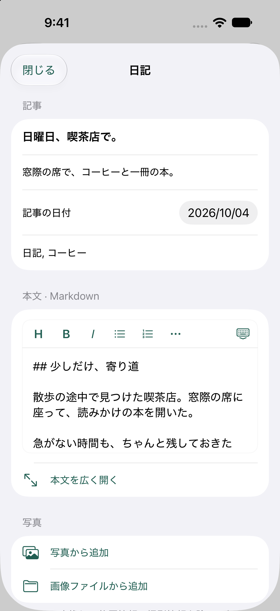
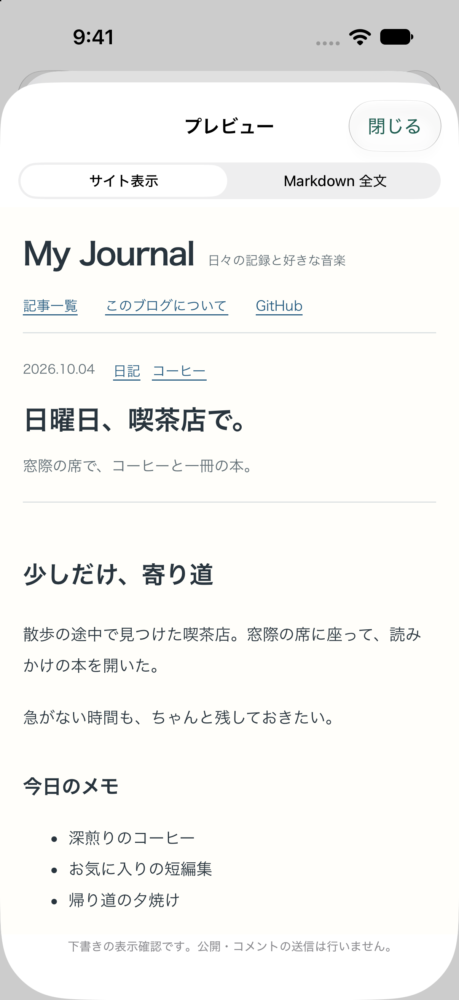

<p align="center">
  
</p>

<h1 align="center">cocoWriter</h1>

<p align="center"><strong>日々の記録を、iPhoneとMacから自分のGitHub Pagesへ。</strong></p>
<p align="center">Markdownで書いて、サイトの見た目で確かめて、写真と一緒に公開する。<br>自分のブログのための、オープンソースの執筆アプリです。</p>

<p align="center">
  <a href="https://github.com/cocoG3k/cocoWriter/actions/workflows/ci.yml"></a>
  
  <a href="LICENSE"></a>
</p>

<p align="center">
  <a href="#最短の導入手順">はじめる</a> ·
  <a href="docs/content-format.md">サイトに合わせる</a> ·
  <a href="docs/README.en.md">English</a>
</p>



## 書くところから、公開するところまで

| 下書きをまとめる | Markdownで書く | サイトの見た目で確認する |
| :---: | :---: | :---: |
|  |  |  |
| 日記も曲紹介も、ひとつの場所に。 | 文章も写真も、自分のペースで。 | 公開前に、読み手の画面を確かめる。 |

<sub>検証用iPhone Simulatorの画面です。記事はREADME用のサンプルで、GitHubへは投稿していません。</sub>

## できること

| 機能 | 内容 |
| --- | --- |
| **文章を書く** | 共通の編集画面で日記・記事の下書き、Markdown編集、プレビュー、書き出し。本文上部のボタンから曲紹介・画像を追加。 |
| **写真を添える** | 位置情報・撮影情報を除いたJPEGに変換し、記事と写真を1コミットで投稿。 |
| **自分のサイトに合わせる** | 日記・旅などのカテゴリと保存先、記事形式・項目名、タグ候補を設定画面で登録。記事ごとにカテゴリと複数のタグを選択。HTML・CSSによるテーマ付きプレビューにも対応。 |
| **公開済みの記事を扱う** | GitHubから記事を読み込み、編集・公開解除。競合時は端末の編集中の内容を保護。 |
| **好きな音楽を残す** | Spotifyの曲・アルバム紹介、曲のストック、YouTube Music・Apple Music・Amazon Music共有拡張。 |
| **自分だけのメモを書く** | 公開せず、端末内に保存するメモ・日記。 |
| **TODOを日記に残す** | メモ入力欄のチェックボタンでTODOに切り替え、締め切りを今日・明日・カレンダーから指定。未完了一覧でチェックすると、本文と締め切りを残したまま完了日を記録します。 |
| **記事の画像をアルバムで見る** | 本文に挿入した画像を一覧・拡大表示。下書き・投稿済みで絞り込み、画像から使用中の記事を開けます。曲ストックはアルバム右上から開きます。 |

音楽サービスからの変換は曲単位です。本体と共有拡張で次の形式を受け付けます。

- YouTube Music: `music.youtube.com/watch?v=曲ID`（YouTubeの`watch`・`youtu.be`形式も正規化）。
- Apple Music: `music.apple.com/{国}/song/{曲ID}`、`/{国}/song/{曲名}/{曲ID}`、`/{国}/album/{アルバム名}/{アルバムID}?i={曲ID}`。
- Amazon Music: `music.amazon.{地域}/tracks/{ASIN}`、`/albums/{アルバムASIN}?trackAsin={曲ASIN}`。対応ホストは com / co.jp / co.uk / de / fr / it / es / ca / com.au / com.br / com.mx / in。
- 短縮共有URL: `apple.co`、`amzn.to`、`a.co`（`/d/…`を含む）。HTTPSの転送先を各段階で検証し、同じサービスの曲が特定できた場合に取得します。商品・アーティスト・アルバムのみのリンクは曲へ変換しません。

[Songlinkの公開曲ページ](https://song.link/a/B084KPC3Q7)で曲ID・サービス・曲種別を確認してSpotify対応リンクを利用します。不足する場合、Appleは[公開iTunes Lookup API](https://developer.apple.com/library/archive/documentation/AudioVideo/Conceptual/iTuneSearchAPI/LookupExamples.html)（共有URLの国を指定）、Apple/Amazonは公開ページのSchema.org曲メタデータを使います。YouTubeは従来のoEmbedを維持しています。取得した情報から従来のMusicBrainz・Appleカタログの照合を行い、Spotify候補を提示します。選択と曲・バージョンの確認は利用者が行います。

2026-10-05の公開ページ確認では、Appleの曲URL・アルバムURLの`i`形式と米国/日本のLookup結果、Amazonの`tracks`形式と公式資料にある`trackAsin`形式、SonglinkのYouTube/Apple/Amazonの曲情報を確認しました。AmazonのHTMLがプレイヤー起動用だけで曲情報を含まない例と、Songlinkがアルバムを返す例も確認しています。その場合は誤った曲を選ばず、理由を表示します。曲名・アーティストの手入力、Spotify検索・共有URL貼り付けで続けられます。

[Apple Music API](https://developer.apple.com/documentation/applemusicapi/generating-developer-tokens)には開発者トークンが必要です。[Amazon Music Web API](https://developer.amazon.com/docs/music/API_web_LWA.html)には認証とサービス側の利用承認が必要で、[閉鎖ベータ](https://www.developer.amazon.com/docs/music/API_web_search_v2.html)です。今回これらの認証APIは追加していません。公開情報の変更、非公開・地域制限、通信障害で候補を取得できない場合があります。アルバム全曲・プレイリストの一括変換には対応しません。

保存項目`youtubeURL`は旧データとの互換性のため維持し、対応する全サービスの共有元URLを格納します。下書き・ストック・共有受信データの形式と、アプリ識別子・App Group・保存先・Keychain設定は変更しません。


### Macで使う

macOS 14以降に対応しています。Mac版はダーク表示を初期設定とし、「設定」→「外観」でライト表示やシステム設定への追従も選べます。Macのテストは `python3 tools/test-mac.py` で専用の検証用アプリを使って実行できます。左のサイドバーから記事・アルバム・曲のストック・自分のメモ・設定を開けます。記事一覧の検索、広いMarkdown本文欄、記事情報パネル、本文と並べるプレビューを備えています。小さなウィンドウでは、パネルを開いている間は記事一覧を畳み、執筆スペースを確保します。

XcodeをインストールしたMacで、リポジトリ直下の `build-mac.command` を実行してください。

```sh
./build-mac.command --open
# 設定済みのアプリを使う場合
./build-mac.command --profile .local/my-blog/profile.json --output .local/my-blog/mac/cocoWriter.app --open
```

既定の出力は `.local/mac/cocoWriter.app` です。このMacで動かすためのローカル署名で作成します。別のMacへの配布に必要なDeveloper ID署名・公証や、Mac App Store向けの配布は含みません。Xcodeからは `cocoWriter` Schemeと **My Mac (Mac Catalyst)** を選んでもビルドできます。

#### Mac版とiPhone版のビルド先

どちらも `ios/` の共通ソースと `cocoWriter` Schemeを使い、ビルド先で分かれます。Mac向けの画面などは `#if targetEnvironment(macCatalyst)` で切り替えます。

| 作るもの | Xcodeのビルド先 | コマンドと成果物 |
| --- | --- | --- |
| Mac版 | My Mac (Mac Catalyst) | `./build-mac.command` → `.local/mac/cocoWriter.app`（ローカル署名） |
| iPhone版 | iPhoneまたはiOS Simulator | `./build-altstore-ipa.command` → `altstore/cocoWriter.ipa`（AltStoreで実機用に署名） |

Mac用スクリプトはMac Catalystを、IPA用スクリプトはiOS実機向けを指定します。片方をビルドしても、もう片方の端末にインストールされることはありません。既存アプリの更新には、そのアプリの設定と署名・インストール方法を維持してください。

ローカル署名版ではKeychainへのトークン保存が利用できません。設定の「この起動中だけトークンを使う」でGitHub認証を利用できます。トークンはメモリ内だけに保持し、アプリ終了後は再入力が必要です。Keychainへ永続保存するMac版には、対応する署名とプロビジョニングプロファイルが必要です。

| 操作 | ショートカット |
| --- | --- |
| 新しい記事（記事画面） | ⌘N |
| 保存（編集内容は自動保存） | ⌘S |
| 本文とプレビューを並べる | ⇧⌘P |
| Markdownを書き出す | ⇧⌘E |
| 設定 | ⌘, |
| 本文の太字・斜体・リンク | ⌘B・⌘I・⌘K |

記事・メモ・写真・曲ストック・トークンは各端末に保存します。iPhoneとMacの自動同期はありません。投稿済みの記事はGitHubから読み込めますが、未公開の下書きや自分のメモは自動転送されません。既存版の更新では、同じアプリ設定を使って識別子・保存フォルダ・Keychainサービスを保ちます。Mac版の作成はiPhoneへのインストールを行いません。

### 自分のGitHub Pagesに合わせて

ユーザーサイト、プロジェクトサイト、独自ドメインに対応。公開先のリポジトリ・ブランチ・URLはアプリの設定画面から選べます。

| ブログの構成 | 記事の保存先の例 | 設定例 |
| --- | --- | --- |
| 同梱のブログテンプレート | `src/content/diary/` | [default.json](config/default.json) |
| Jekyll | `_posts/` | [jekyll.json](config/jekyll.json) |
| Hugo | `content/posts/` | [YAML](config/hugo-yaml.json) · [TOML](config/hugo-toml.json) · [JSON](config/hugo-json.json) |
| 既存サイトのテーマ付きプレビュー | サイトに合わせて指定 | [sfuji.orgでの検証](docs/SFUJI_VALIDATION.md) |

アプリはiOSとMac Catalystに対応し、GitHub Pagesに公開するのはブログです。既存サイトには、設定画面で[対応する記事形式](docs/content-format.md)と保存先を合わせます。

**必要なもの：Mac、Swift 6.2以降を含むXcode、iOS 17以降。** ソースからビルドして使います。App Storeでの配信はありません。同梱のブログテンプレートにはNode.js 22以降を使います。

アプリ名・識別子・保存先・公開先の初期値も、[自分用の設定](docs/app-variants.md)としてまとめられます。生成したXcodeプロジェクトは共通ソースを直接参照するため、既存アプリの識別子とデータを引き継ぎながらcocoWriterで開発を続けられます。

## 最短の導入手順

まずソースを取得します。

```sh
git clone https://github.com/cocoG3k/cocoWriter.git
cd cocoWriter
```

### 1. ブログを用意する

```sh
python3 tools/create-blog.py ../my-journal
cd ../my-journal
```

作成されたディレクトリの[README](site-template/README.md)に従い、その内容を新しいGitHubリポジトリの**ルート**へ登録します。`site-template/` 自体をリポジトリ直下のサブフォルダに置く構成ではありません。ブログにはサンプル記事が1件入っているため、公開前に削除・編集してください。

GitHubの Settings → Pages → Build and deployment → Source を **GitHub Actions** にし、Actionsの「Publish blog to GitHub Pages」を実行します。ワークフローが公開URLを取得し、リポジトリ名を含むパスを自動で反映します。[GitHub公式手順](https://docs.github.com/en/pages/getting-started-with-github-pages/using-custom-workflows-with-github-pages)

既存ブログを使う場合は、[記事設定](docs/content-format.md)で、そのサイトに合わせた保存先とFront Matterを指定します。ビルド時のJSONで初期値を用意することもできます。

### 2. iPhoneアプリをビルドする

Swift Markdown 0.8.0を初回ビルド時に取得します。

```sh
cd ../cocoWriter
# 既存サイトなら config/jekyll.json や config/hugo-toml.json を選択
python3 tools/configure-blog.py config/default.json
python3 tools/configure-signing.py --bundle-id com.yourname.cocoWriter
open ios/cocoWriter.xcodeproj
```

`com.yourname.cocoWriter` は自分固有の識別子に変更してください。この補助ツールは本体・共有拡張・App Groupの識別子を一緒に変更します。公開用の初期値は `org.example.cocoWriter` で、署名チームは空です。

Xcodeで `cocoWriter` と `cocoWriterShare` の Signing & Capabilities に自分のTeamを設定し、同じApp Groupを登録します。実機で共有拡張を使うには、そのApp Groupへアクセスできる署名が必要です。[AppleのApp Group説明](https://developer.apple.com/documentation/xcode/configuring-app-groups)

Scheme `cocoWriter` と実行先のiPhoneを選び、Runします。元のCocoG Writerはそのまま残ります。自分でアプリ識別子を元アプリと同じにしないでください。

AltStore用のIPAを作る場合は `./build-altstore-ipa.command` を実行します。生成先は `altstore/` です。実機用の署名はAltStoreで行います。共有拡張を取り込み対象に残してください。

### 3. 公開先を設定する

アプリの「設定」→「GitHub公開の接続設定」で次を入力し、「公開先の設定を保存」を押します。

| 設定 | プロジェクトサイトの例 |
| --- | --- |
| GitHubユーザー名・組織名 | `username` |
| リポジトリ名 | `my-journal` |
| ブランチ | `main` |
| 公開サイトURL | `https://username.github.io/my-journal/` |
| サイト名・説明 | 自分のブログ名・説明 |

ブログの `site.config.json` にも同じサイト名と説明を設定します。アプリの設定は端末内のプレビューを変更するもので、サイト設定ファイルを自動更新しません。

GitHubで対象リポジトリだけを選んだFine-grained personal access tokenを作り、**Contents: Read and write** を許可して、アプリのSecureFieldからKeychainに保存します。アプリはワークフロー自体を書き換えないため、投稿用トークンにWorkflowsの書き込み権限は不要です。[GitHubの権限一覧](https://docs.github.com/en/rest/authentication/permissions-required-for-fine-grained-personal-access-tokens)

ブランチを変更する場合は、ブログ側の `.github/workflows/pages.yml` の `on.push.branches` とPagesの環境の許可ブランチも揃えます。保護ブランチに直接書き込めない設定では投稿できません。この版はPR経由の投稿に対応していません。

### 4. 記事を公開する

下書きを作成し、プレビューと送信内容を確認して「この内容をGitHubに保存・公開」を押します。GitHubへの保存後、サイトのActionsが成功したことと公開ページを確認します。GitHubのコミット成功とPagesへの反映は別の段階です。

## 保存と公開先の変更

<details>
<summary>端末内のデータ・バックアップ・別のブログへの切り替えについて</summary>

記事・自分用メモ・曲ストックは端末内に保存されます。自分用メモをGitHubへ送る機能はありません。クラウド同期はなく、アプリを削除すると端末内データも失われるため、必要な記事は書き出して保管してください。

公開先を変えると保存済みトークンを削除します。投稿済み・送信結果の確認待ち・GitHub由来の記事や画像の復元履歴がある間と、GitHubへの通信中は投稿先の変更を停止します。サイト名・公開URLは変更できます。別の投稿先へ移る場合は記事を書き出し、確認待ちを解決し、接続済みの記事を**端末のゴミ箱から完全削除**してから変更してください。端末からの整理と「公開解除」は別の操作です。

既存のCocoG Writerの保存データ・認証情報は自動移行しません。

</details>

## 開発・確認

```sh
python3 tools/check-project.py
python3 tools/test_build_profiles.py
python3 tools/test_app_variants.py
python3 tools/test-ios.py
cd site-template
npm ci
npm test
npm run build
npm run preview
```

ブログにはNode.js 22以降が必要です。プレビューURLはコマンドの出力に表示されます。ルートのGitHub ActionsはiOSテストとブログのビルドを行い、ブログを公開するワークフローは `site-template/.github/workflows/` にあります。

現在の確認範囲は[検証記録](docs/VALIDATION.md)を参照してください。

## 構成・ライセンス

```text
config/                 標準・Jekyll・Hugo・sfuji.org用のビルド設定例
ios/                    アプリ・共有拡張・Xcodeプロジェクト・XCTest
preview-templates/      サイトの見た目に合わせるHTML/CSSとライセンス
site-template/          独立したGitHub Pagesブログの雛形
tools/                  ブログ作成・識別子設定・ビルド確認
docs/                   記事形式・英語ガイド・検証記録
.github/workflows/      公開プロジェクトのCI
```

CocoG Writerを元にした独立プロジェクトです。元のアプリとは別のアプリ識別子・保存領域を使い、特定のドメインやGitHubアカウントには固定されていません。アイコンはCocoG Writerと共通です。

プロジェクトのコードと同梱する独自の素材は[MIT License](LICENSE)です。Swift Markdown、cmark、ブログのnpmパッケージはそれぞれのライセンスが適用されます。[第三者ライセンス](THIRD_PARTY_NOTICES.md)と同梱する原文の通知を保持してください。生成したブログ記事や利用者の写真の権利を、このライセンスへ変更するものではありません。

[GitHubでの公開・ソースZIPの作成手順](docs/publishing.md)も用意しています。変更の提案は[CONTRIBUTING](CONTRIBUTING.md)を参照してください。
